# بررسی صفر تا صد ساخت سرور ابری در پنل Yandex Cloud

> تهیه: واحد محصول ایران سرور · تاریخ بررسی: ۱۰ آبان ۱۴۰۵ (2026-11-01) · نسخه: `yandex-vm-walkthrough-v1.0`
> مسیر در پنل: Compute Cloud ← Virtual machines ← Create virtual machine
> همه‌ی عکس‌ها در پوشه‌ی [`images/`](images/) هستند. نام و ایمیل صاحب حساب در عکس‌ها پوشانده شده است.

هدف این سند: هر گزینه‌ای که یاندکس در فرم ساخت ماشین و صفحه‌ی جزئیات سرویس می‌دهد، با توضیح این‌که چیست و چه نیازی را حل می‌کند، تا برای طراحی پنل سرور ابری ایران سرور (روی OpenStack) الگو بگیریم.

---

## خلاصه‌ی فرایند

فرم ساخت یک صفحه‌ی طولانی است (نه wizard چندمرحله‌ای) و در سمت راست یک **جعبه‌ی قیمت زنده** دارد که با هر تغییر، هزینه را به تفکیک قلم (CPU، RAM، دیسک، IP، بکاپ) به‌روز می‌کند. بخش‌ها به این ترتیب‌اند:

| # | بخش | الزامی؟ | پیش‌فرض |
|---|---|---|---|
| ۱ | General information (نام، توضیح، برچسب) | نام الزامی | نام خودکار مثل `compute-vm-2-2-20-ssd-…` |
| ۲ | Boot disk image (Marketplace / Container Solution / Custom) | بله | Ubuntu 24.04 |
| ۳ | Location (زون) | بله | ru-central1-d |
| ۴ | Disks and file storages | دیسک بوت الزامی | SSD، ۲۰ گیگ |
| ۵ | Computing resources | بله | Standard، Intel، ۲ vCPU، ۲ گیگ |
| ۶ | Network settings | ساب‌نت الزامی | IP عمومی Auto، سکیوریتی گروپ پیش‌فرض |
| ۷ | Access (SSH key یا OS Login) | بله | SSH key |
| ۸ | Backup (Cloud Backup یا Disk snapshots) | خیر | روشن، Cloud Backup روزانه |
| ۹ | Additional (سرویس اکانت، کنسول سریال، نگهداری، مانیتورینگ، Placement) | خیر | — |
| ۱۰ | Metadata | خیر | — |
| ۱۱ | Create VM / Cancel / Code generation | — | — |

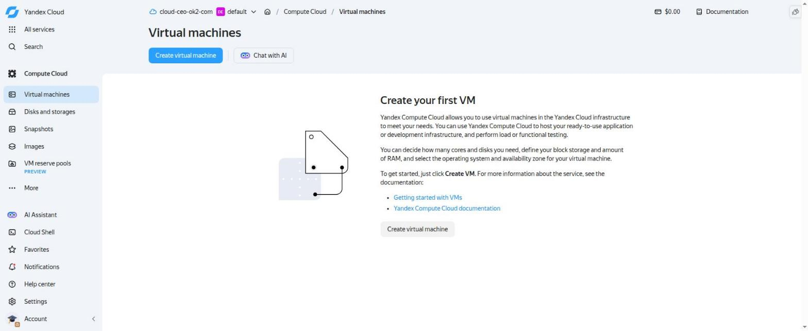
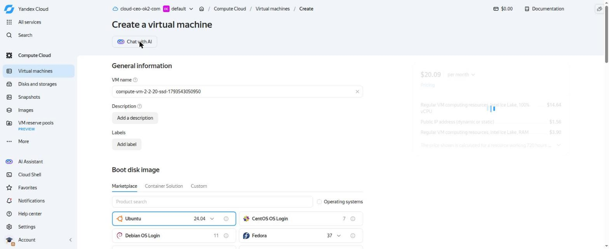

---

## ۱. General information

| فیلد | چیست | چه نیازی را حل می‌کند |
|---|---|---|
| VM name | نام ماشین؛ پیش‌فرض از روی کانفیگ ساخته می‌شود (مثلاً `compute-vm-2-2-20-ssd-<timestamp>`) | کاربر بدون فکر کردن به نام می‌تواند ادامه دهد؛ نام از کانفیگ خبر می‌دهد. همین نام hostname و FQDN داخلی هم می‌شود |
| Description | توضیح آزاد | یادداشت برای تیم (کاربرد ماشین، صاحب آن) |
| Labels | برچسب key=value | دسته‌بندی، فیلتر و **تفکیک هزینه** بر اساس پروژه یا تیم |

**برای ایران سرور:** نام پیش‌فرض گویا و فیلد Labels برای مشتری‌های سازمانی (تفکیک هزینه‌ی دپارتمان‌ها) ارزشمند است.

---

## ۲. Boot disk image (تصویر سیستم‌عامل)

سه تب دارد:

### الف) Marketplace
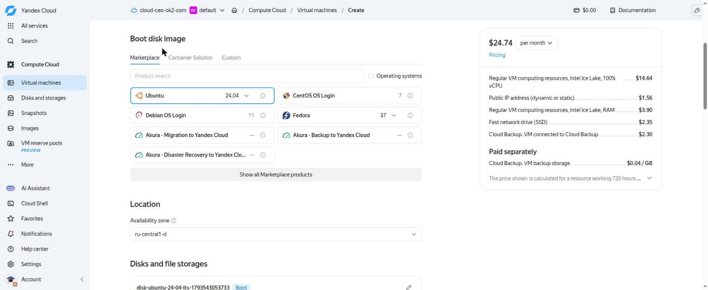

- کارت‌های پرکاربرد: Ubuntu، CentOS OS Login، Debian OS Login، Fedora و چند محصول Akura (مهاجرت، بکاپ و DR به یاندکس).
- روی هر سیستم‌عامل یک **منوی نسخه** هست. برای Ubuntu نسخه‌های 24.04، 22.04، 20.04 و 18.04 به‌علاوه‌ی نسخه‌های آماده‌ی GPU (20.04 GPU، GPU Cluster، GPU A100) همه «Free».
- چک‌باکس «Operating systems» فقط سیستم‌عامل‌ها را نشان می‌دهد.

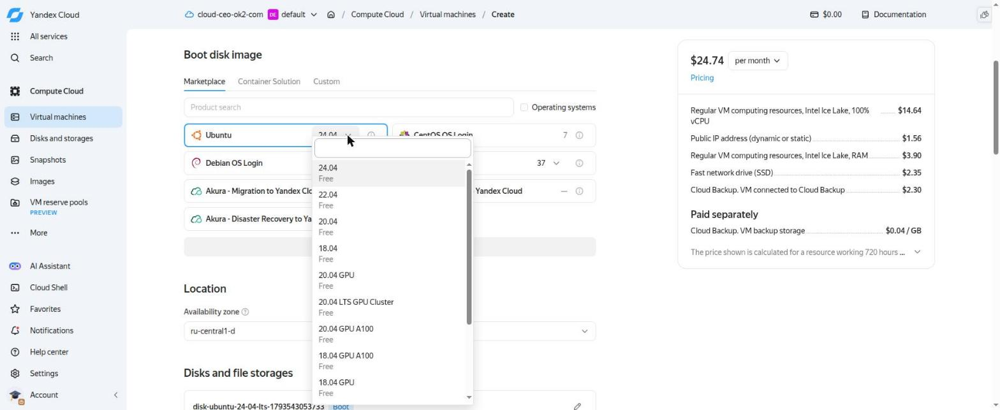

**Show all Marketplace products:** کاتالوگ کامل با **۲۳۸ محصول**، جست‌وجو، مرتب‌سازی و فیلتر:
- **دسته‌ها:** AI Agents، Admin tools & DevOps (۱۷)، Analytics (۱۳)، Business applications (۳۷)، CMS (۱۱)، Databases (۲۴)، Developer tools (۳۶)، MCP Servers (۴)، نرم‌افزارهای ثبت‌شده در رجیستری روسیه (۶۲) و غیره
- **مدل پرداخت لایسنس:** Free (۱۰۰)، Hourly / PAYG (۸۸)، Monthly (۲۴)، BYOL (۱۷)، Subscription (۱۰)
- **سیستم‌عامل:** Linux (۱۹۷)، Windows (۳۵)
- **فیلتر ناشر و Vendor**

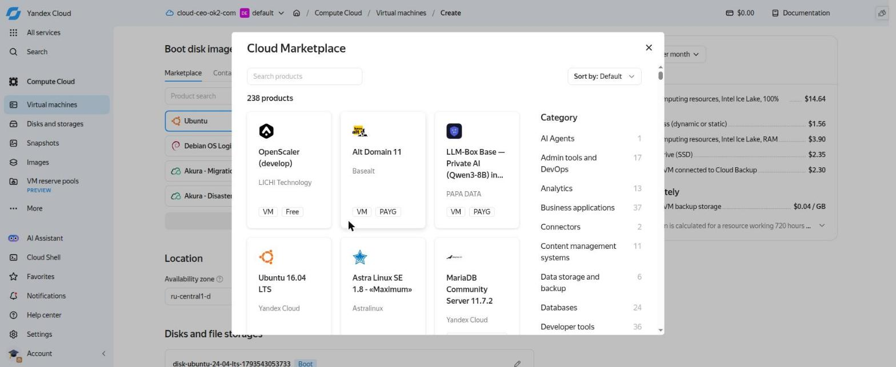

**چه نیازی را حل می‌کند:** مشتری به‌جای سرور خام، نرم‌افزار آماده (دیتابیس، VPN، فایروال، ویندوز با لایسنس) را با یک کلیک تحویل می‌گیرد و هزینه‌ی لایسنس ساعتی روی همان فاکتور می‌آید.

### ب) Container Solution
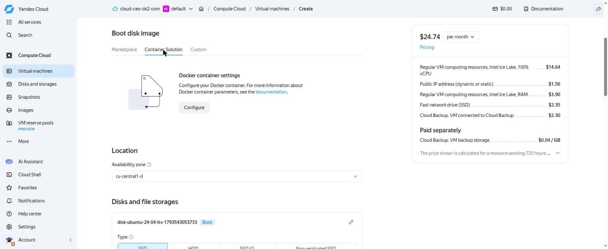

ماشین با سیستم‌عامل بهینه برای Docker (Container Optimized Image) ساخته می‌شود و کانتینر مشتری خودکار اجرا می‌شود. دو حالت دارد:
- **Configure container:** نام، Docker image از Container Registry یاندکس یا لینک دلخواه، Command، آرگومان‌ها، متغیرهای محیطی، Restart policy و گزینه‌های پیشرفته (TTY، stdin، privileged)
- **Docker Compose:** ادیتور برای چسباندن فایل compose

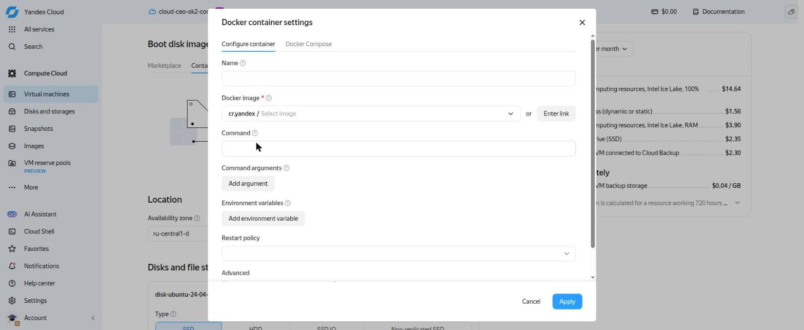
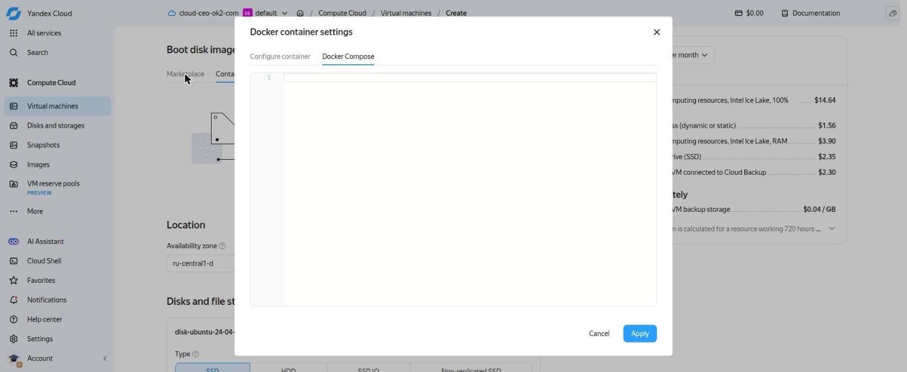

**چه نیازی را حل می‌کند:** توسعه‌دهنده بدون نصب Docker و نوشتن سرویس systemd، اپش را روی یک VM اختصاصی بالا می‌آورد. **برای ایران سرور:** شبیه «برنامه‌های آماده» فعلی است، با این تفاوت که مشتری ایمیج خودش را می‌آورد.

### ج) Custom
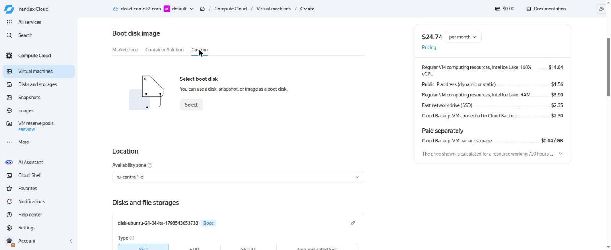

انتخاب دیسک بوت از **Snapshot**، **Image** شخصی یا **دیسک موجود** (Attach existing). در همین دیالوگ مشخصات دیسک هم تنظیم می‌شود:
- نوع: SSD، HDD، SSD IO، Non-replicated SSD
- حجم: ۱ تا ۸۱۹۲ گیگ (فقط قابل افزایش، نه کاهش)
- **Block size:** ۴ تا ۱۲۸ کیلوبایت. حداکثر حجم دیسک را تعیین می‌کند و بعداً قابل تغییر نیست.
- **Delete along with the virtual machine:** با حذف VM دیسک هم حذف شود یا بماند
- **Encrypted disk:** رمزنگاری دیسک با کلید KMS

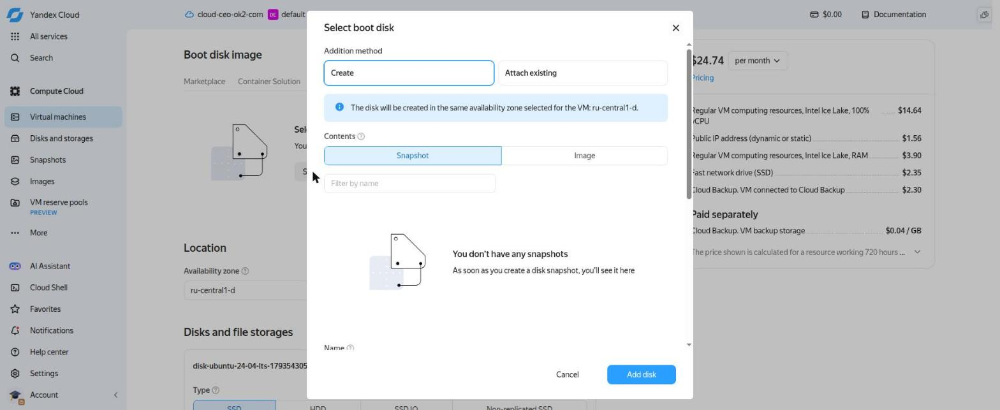
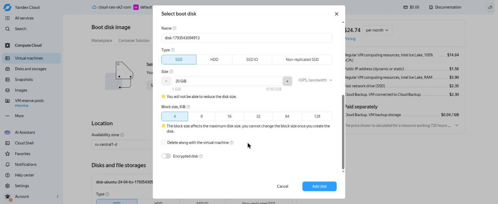

**چه نیازی را حل می‌کند:** بازیابی از اسنپ‌شات، کلون کردن یک سرور آماده و ساخت سرور از ایمیج طلایی سازمان.

---

## ۳. Location (زون در دسترس‌پذیری)

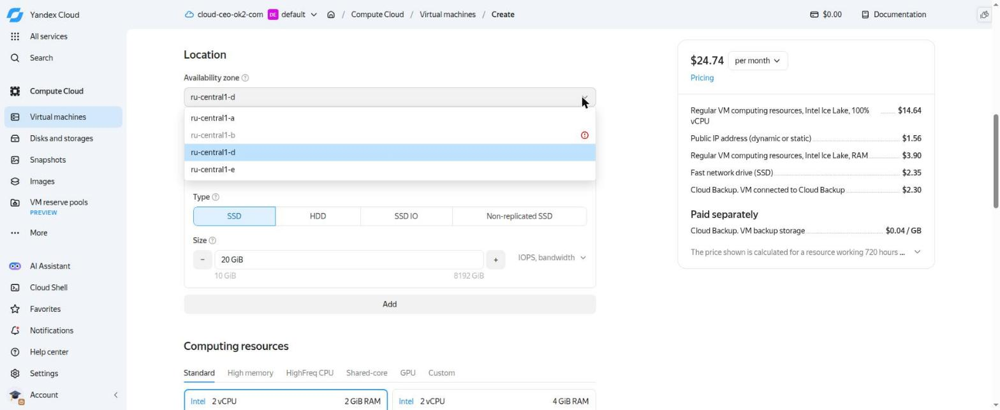

- زون‌ها: `ru-central1-a`، `ru-central1-b`، `ru-central1-d`، `ru-central1-e`
- `ru-central1-b` با آیکون قرمز غیرفعال بود؛ در حال بازنشستگی است و منبع جدید نمی‌پذیرد.
- دیسک‌ها و ساب‌نت باید در همان زون باشند و فرم این را خودکار رعایت می‌کند.

**چه نیازی را حل می‌کند:** پخش کردن سرورها در چند دیتاسنتر برای تحمل خطا و انتخاب محل نزدیک‌تر.

---

## ۴. Disks and file storages

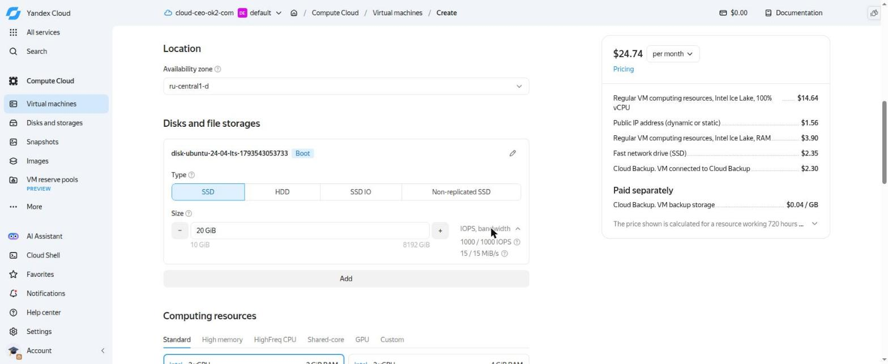

- **انواع دیسک:**

| نوع | کاربرد |
|---|---|
| SSD (network-ssd) | عمومی، پیش‌فرض |
| HDD (network-hdd) | ارزان، برای داده‌ی کم‌مصرف و آرشیو |
| SSD IO (network-ssd-io-m3) | IOPS بالا و تکرار سه‌گانه، برای دیتابیس‌های سنگین |
| Non-replicated SSD | سریع‌ترین و ارزان‌تر، ولی **بدون تکرار**. خرابی سخت‌افزار یعنی از دست رفتن داده |

- **حجم:** ۱۰ گیگ (حداقل برای Ubuntu) تا ۸۱۹۲ گیگ، با دکمه‌ی + و −
- **IOPS, bandwidth:** نمایش سقف کارایی بر اساس نوع و حجم. مثلاً SSD بیست‌گیگی ۱۰۰۰ IOPS و ۱۵ MiB/s، و HDD ده‌گیگی ۳۰۰ IOPS و ۳۰ MiB/s. **کارایی با حجم بالا می‌رود.**
- **Add:** افزودن دیسک دوم یا **File storage**. فایل‌استوریج یک فایل‌سیستم مشترک است که به چند VM هم‌زمان وصل می‌شود.

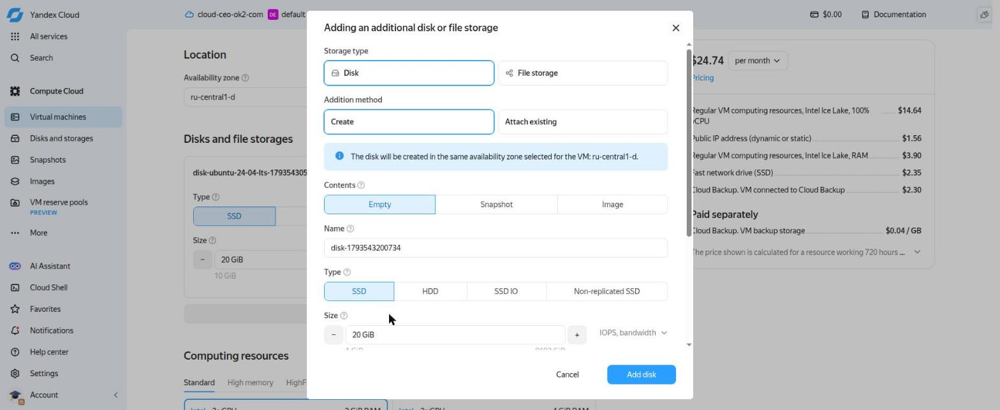
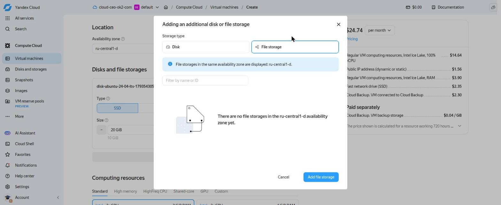

**برای ایران سرور (Ceph):** نمایش IOPS هر نوع دیسک کنار حجم، به مشتری کمک می‌کند بفهمد چرا دیسک بزرگ‌تر سریع‌تر است. معادل در OpenStack، QoS روی Cinder volume type است.

---

## ۵. Computing resources (منابع پردازشی)

شش تب دارد. پنج تب اول **پریست‌های آماده** هستند و تب ششم کانفیگ کاملاً دلخواه:

| تب | پریست‌ها | مشتری هدف |
|---|---|---|
| Standard | Intel 2/2، 2/4، 4/4، 4/8 · AMD 8/8، 8/16 (vCPU/GiB) | عمومی |
| High memory | Intel 2/8، 2/16، 4/16، 4/32 · AMD 8/32، 8/64 | دیتابیس، کش، Java |
| HighFreq CPU | Intel 2/2 تا 4/8 · AMD 8/16، 32/64 | بار پردازشی تک‌نخی، بازی، شبیه‌سازی |
| Shared-core | با ۲۰٪ یا ۵۰٪ کارایی تضمینی، از 2 vCPU و 1 GiB | تست، سایت کم‌بازدید، ارزان‌ترین گزینه |
| GPU | 1، 2، 4 و 8 GPU روی AMD Epyc 9474F with Gen2، از 18 vCPU و 144 GiB تا 180 vCPU و 1440 GiB | هوش مصنوعی و رندر |
| Custom | انتخاب آزاد پلتفرم، تعداد vCPU، درصد کارایی و RAM | هر نیاز خاص |

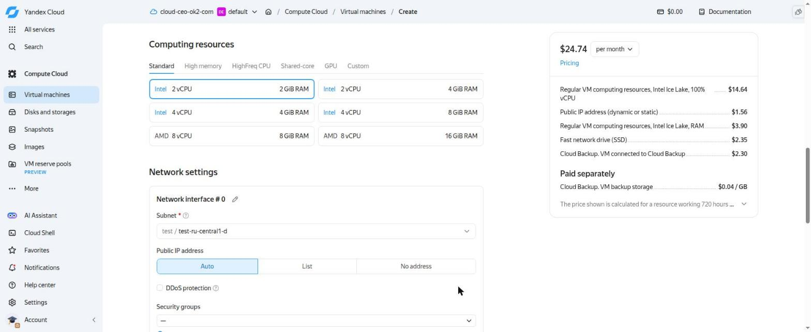
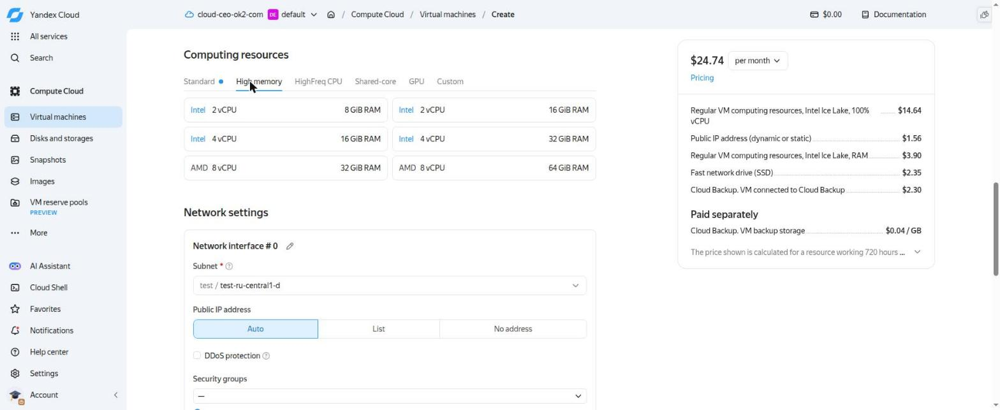

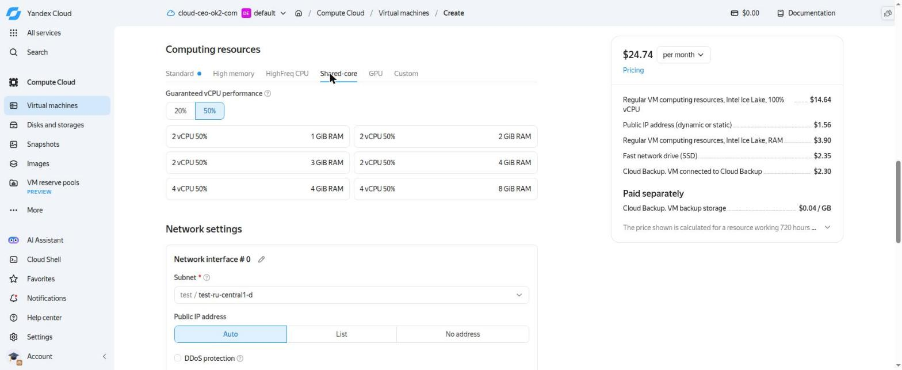
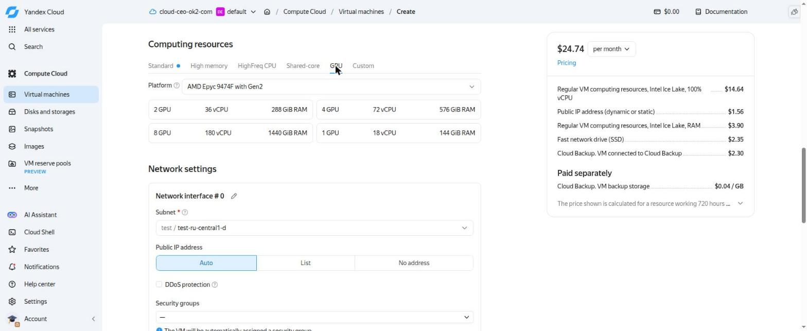
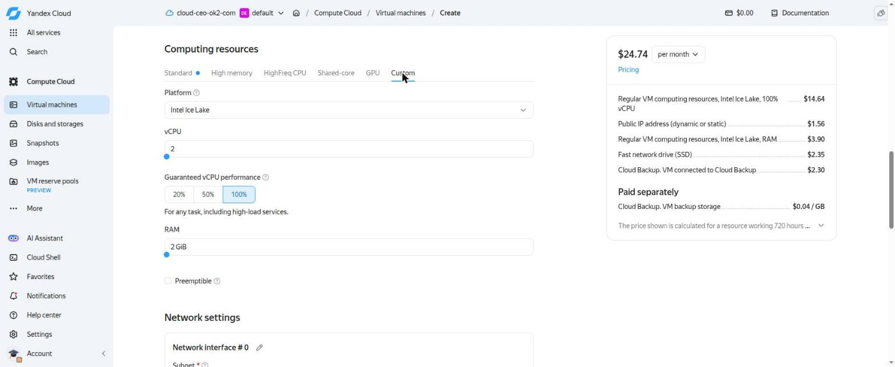

### تب Custom در جزئیات

- **Platform (نسل پردازنده):**
  - بدون GPU: AMD Zen 4، AMD Zen 4 (Compute Optimized)، Intel Broadwell (غیرفعال)، Intel Cascade Lake، Intel Ice Lake، Intel Ice Lake (Compute Optimized)
  - با GPU: AMD EPYC with A100 (غیرفعال)، AMD Epyc 9474F with Gen2، Intel Broadwell/Cascade Lake with V100 (غیرفعال)، Intel Ice Lake with T4، Intel Ice Lake with T4i. برای پلتفرم‌های GPU علامت زرد کوتا دیده می‌شود، چون کوتای GPU به‌طور پیش‌فرض صفر است.
- **vCPU:** اسلایدر
- **Guaranteed vCPU performance:** ۲۰٪، ۵۰٪ یا ۱۰۰٪. سهم تضمینی از یک هسته‌ی فیزیکی است و هزینه را مستقیم کم می‌کند.
- **RAM:** اسلایدر. نسبت مجاز RAM به vCPU به پلتفرم بستگی دارد.
- **Preemptible:** ماشین موقت (توضیح زیر)

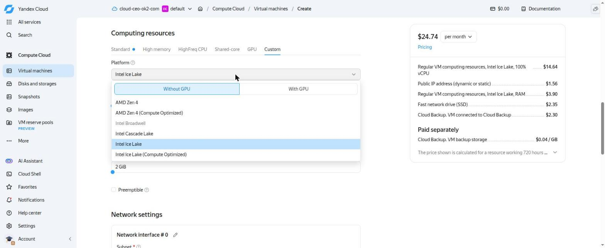
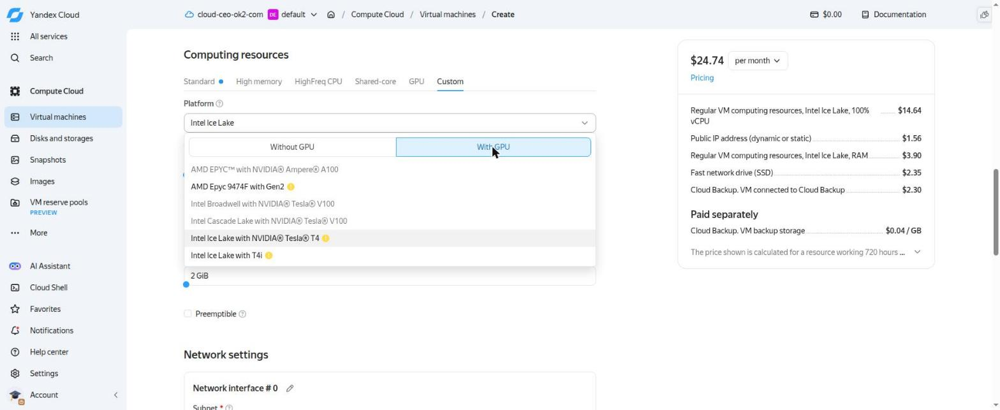

### Preemptible (سرور لحظه‌ای)

متن خود پنل: ماشین Preemptible **حداکثر ۲۴ ساعت** کار می‌کند و یاندکس هر زمان می‌تواند آن را متوقف کند، ولی با تخفیف زیاد. با توقف **حذف نمی‌شود** و داده‌ها می‌مانند؛ برای ادامه باید دوباره روشن شود.

اثر قیمتی در همین فرم (Ubuntu، ۲ vCPU، ۲ گیگ، SSD بیست‌گیگی، با Cloud Backup):

| حالت | قیمت ماهانه |
|---|---|
| عادی، ۱۰۰٪ vCPU | ۲۴٫۷۴ دلار |
| Preemptible، ۱۰۰٪ vCPU | ۱۱٫۲۰ دلار (CPU از ۱۴٫۶۴ به ۴٫۰۱ و RAM از ۳٫۹۰ به ۰٫۹۸) |

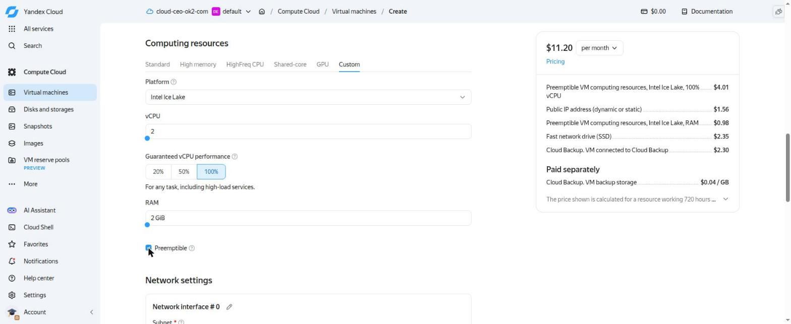

**چه نیازی را حل می‌کند:** CI/CD، پردازش دسته‌ای، تست بار و آموزش مدل که قطع شدن را تحمل می‌کنند، با حدود ۷۰٪ تخفیف روی CPU و RAM.

---

## ۶. Network settings

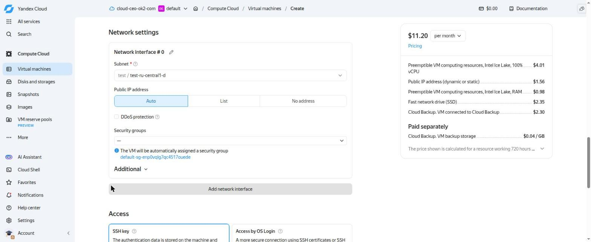

| گزینه | توضیح | چه نیازی را حل می‌کند |
|---|---|---|
| Subnet | انتخاب ساب‌نت از شبکه‌های فولدر. داخل لیست لینک «Create network» و «Create subnet» هست و تیک «All folders» ساب‌نت‌های فولدرهای دیگر را هم نشان می‌دهد | شبکه‌ی خصوصی بین سرورهای مشتری |
| Public IP: Auto | IP عمومی **پویا** که با Stop/Start ممکن است عوض شود | سریع‌ترین راه دسترسی از اینترنت |
| Public IP: List | انتخاب IP **استاتیک** رزروشده. در این حساب IP رزروشده‌ای نبود و پیام خطا با لینک Address list آمد | IP ثابت برای DNS و وایت‌لیست |
| Public IP: No address | بدون IP عمومی | سرورهای داخلی پشت NAT یا لود بالانسر |
| DDoS protection | حفاظت DDoS روی همین IP، با هزینه بر اساس هر گیگابایت ترافیک فیلترشده | سایت‌های در معرض حمله |
| Security groups | فایروال stateful. اگر خالی بماند گروه پیش‌فرض فولدر اعمال می‌شود. «Add security group» گروه جدید می‌سازد | کنترل پورت‌ها بدون ورود به سرور |
| Additional ← Internal IPv4 | IP داخلی خودکار یا دستی | آدرس ثابت داخلی برای سرویس‌ها |
| Additional ← DNS settings for internal addresses | ساخت رکورد DNS داخلی: Zone، FQDN (ساب‌دامین یا @)، TTL | نام‌گذاری سرورها در شبکه‌ی داخلی |
| Add network interface | کارت شبکه‌ی دوم | اتصال هم‌زمان به چند شبکه، مثل جدا کردن ترافیک مدیریت |

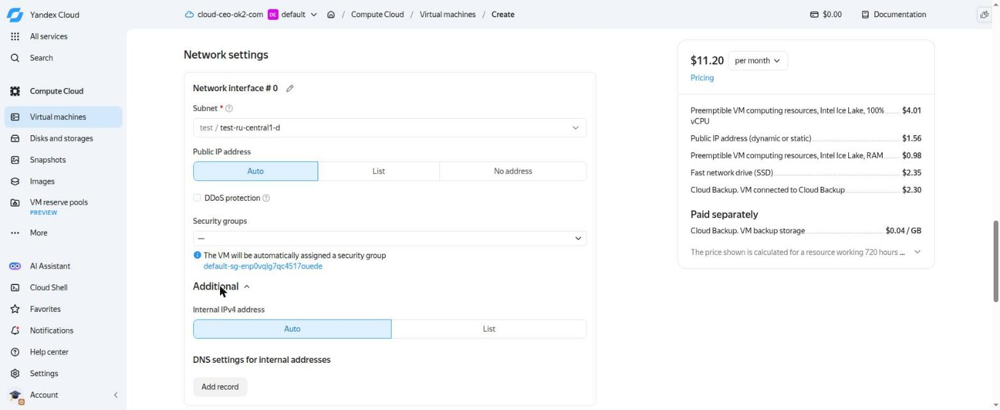
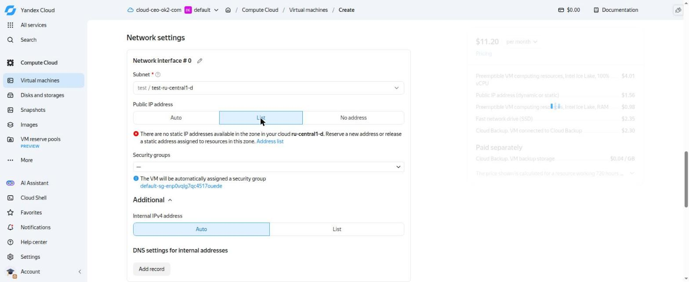
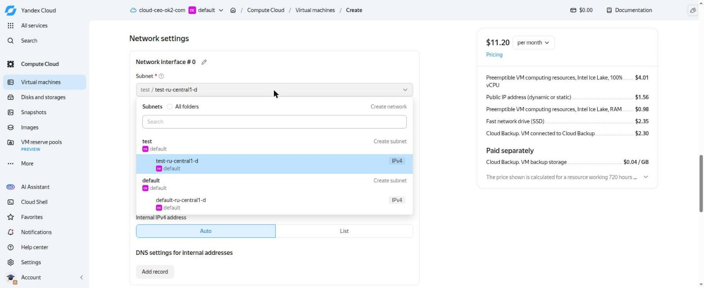
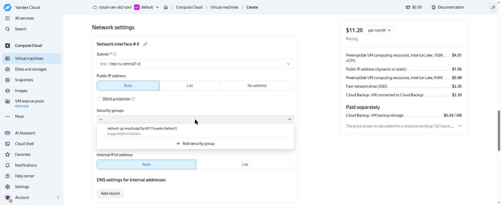
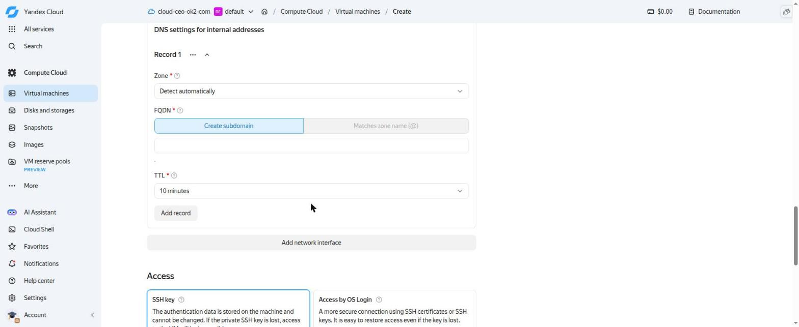

---

## ۷. Access (دسترسی)

دو روش:

| روش | توضیح پنل | فیلدها |
|---|---|---|
| SSH key | کلید روی ماشین ذخیره می‌شود و قابل تغییر نیست. اگر کلید خصوصی گم شود، دسترسی ممکن نیست | Login (نام کاربر ادمین) و SSH key. کلید را می‌شود **دستی وارد کرد، از فایل بارگذاری کرد یا همان‌جا ساخت (Generate key)** |
| Access by OS Login | اتصال امن‌تر با گواهی یا کلید SSH که به **حساب کاربری یاندکس** گره خورده است. با گم شدن کلید، دسترسی قابل بازیابی است | فیلدی ندارد؛ دستور اتصال بعد از ساخت در صفحه‌ی VM نمایش داده می‌شود |

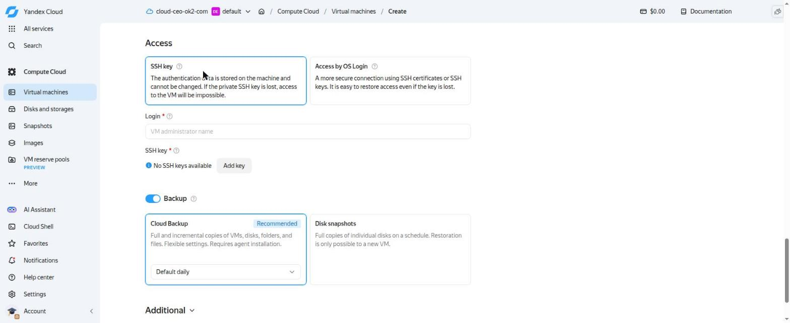
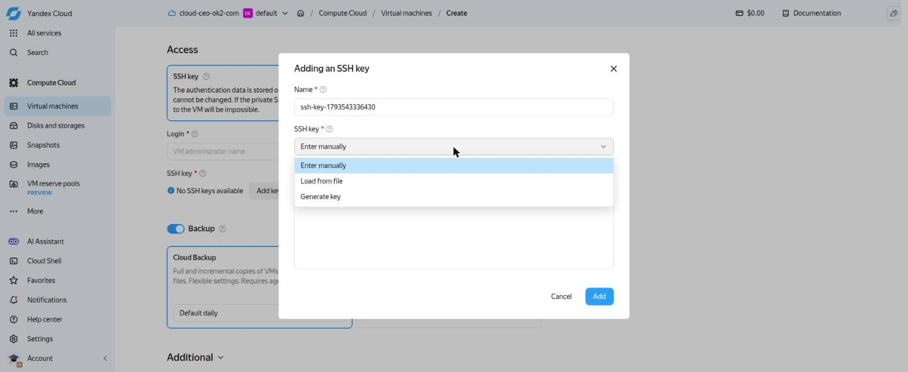
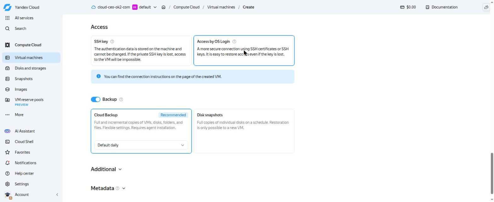

**برای ایران سرور:** دکمه‌ی «Generate key» داخل فرم، مشکل مشتری‌ای را حل می‌کند که کلید SSH ندارد. OS Login هم معادل اتصال کلید به حساب کاربری پنل است.

---

## ۸. Backup

| گزینه | توضیح | هزینه |
|---|---|---|
| Cloud Backup (پیشنهاد یاندکس) | بکاپ کامل و افزایشی از کل VM، دیسک، پوشه یا فایل. **نیاز به نصب ایجنت دارد.** سیاست‌های آماده: روزانه ساعت ۰۲:۴۰، هفتگی دوشنبه ۰۱:۰۵، ماهانه روز اول ساعت ۰۵:۳۰، هرکدام با نگهداری ۱۵ نسخه، یا «Create policy» | ۲٫۳۰ دلار در ماه برای اتصال VM، به‌علاوه‌ی ۰٫۰۴ دلار برای هر گیگ |
| Disk snapshots | اسنپ‌شات کامل دیسک‌ها با زمان‌بندی (`default-daily-schedule`). **بازیابی فقط روی VM جدید.** هشدار پنل: اسنپ‌شات از منابع VM استفاده می‌کند و اگر هنگام نوشتن گرفته شود، داده ممکن است ناسازگار باشد | ۰٫۰۳ دلار برای هر گیگ |

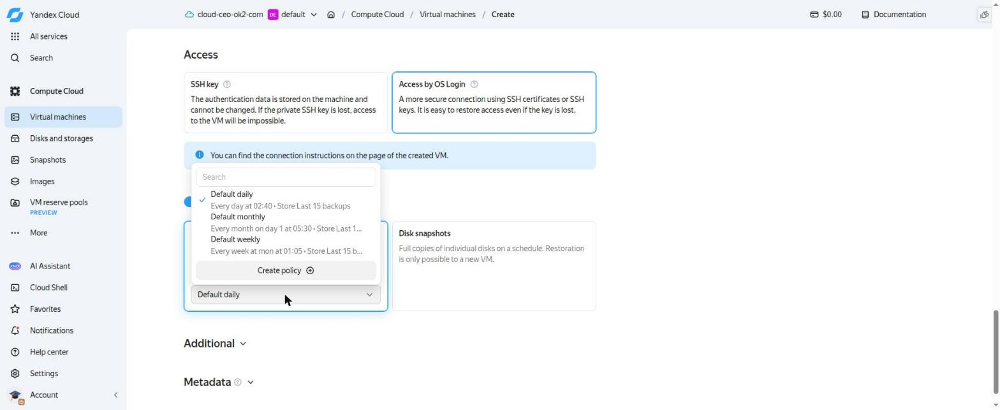
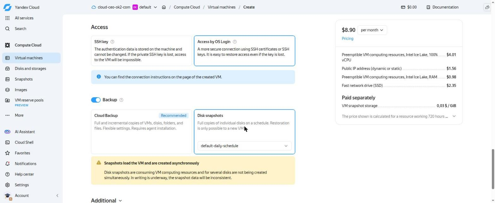

**نکته:** بکاپ به‌طور پیش‌فرض **روشن** است و ۲٫۳۰ دلار به قیمت اضافه می‌کند؛ یک الگوی فروش افزوده (upsell) که مشتری باید خودش خاموشش کند. Cloud Backup را بعد از ساخت فقط وقتی VM خاموش است می‌شود فعال کرد.

---

## ۹. Additional

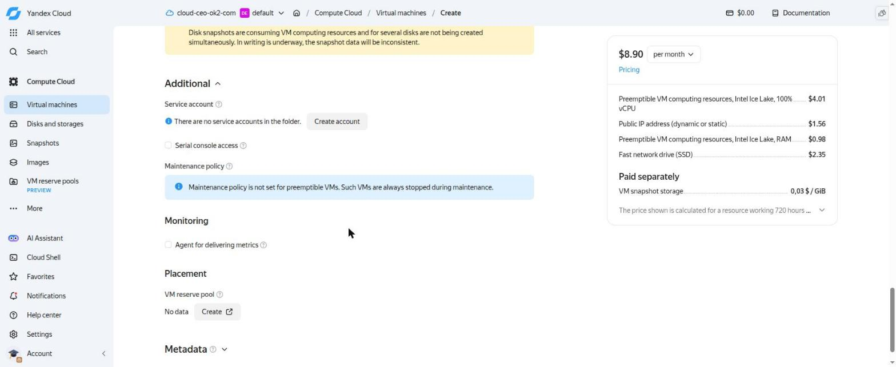

| گزینه | توضیح | چه نیازی را حل می‌کند |
|---|---|---|
| Service account | هویت ماشین برای کار با سرویس‌های دیگر یاندکس، مثل ارسال متریک به Monitoring، لاگ به Cloud Logging و اتصال به Cloud Backup | دسترسی اپ داخل VM به S3 و سرویس‌های دیگر **بدون گذاشتن کلید** روی سرور |
| Serial console access | فعال کردن کنسول سریال تعاملی | دسترسی وقتی SSH یا شبکه خراب است (بازیابی فایروال، fstab خراب) |
| Maintenance policy | رفتار هنگام نگهداری میزبان | انتخاب بین «بدون قطعی» و «ری‌استارت کنترل‌شده» |
| Monitoring ← Agent for delivering metrics | نصب ایجنت متریک برای Monitoring، Prometheus و Cloud Logging. ارسال متریک و لاگ هزینه‌ی جدا دارد | متریک‌های داخل سیستم‌عامل مثل RAM و دیسک، که از بیرون دیده نمی‌شوند |
| Placement ← VM reserve pool | انتخاب از استخر منابع رزروشده در یک زون | **تضمین ظرفیت** برای ساخت ماشین در زمان اوج |

**Maintenance policy** (فقط برای ماشین غیر Preemptible؛ ماشین Preemptible هنگام نگهداری همیشه متوقف می‌شود):

| مقدار | رفتار |
|---|---|
| Default | رویداد نگهداری ساخته نمی‌شود؛ مهاجرت زنده (live migration) انجام می‌شود |
| Dynamic migration | رویداد ساخته می‌شود و یک دقیقه بعد مهاجرت زنده انجام می‌شود |
| Restart | رویداد ساخته می‌شود؛ VM متوقف و یک دقیقه بعد دوباره روشن می‌شود، بدون اعلان |

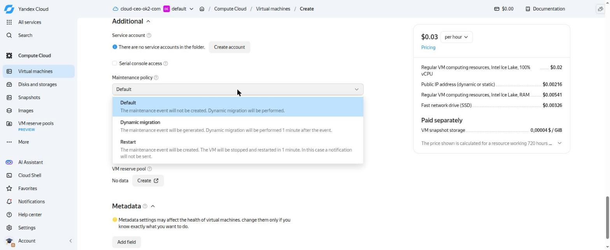

---

## ۱۰. Metadata

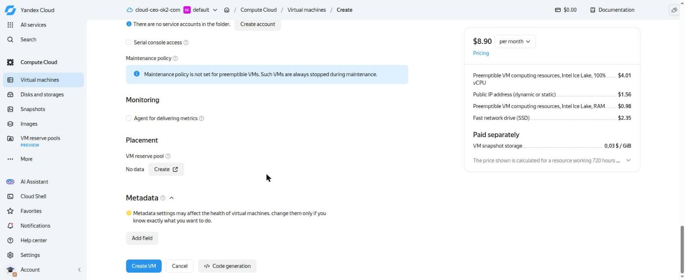

جفت‌های key=value که cloud-init داخل ایمیج‌های لینوکسی می‌خواند، مثل `user-data` برای اسکریپت اولیه و `ssh-keys`. پنل هشدار می‌دهد که تغییر نادرست می‌تواند سلامت VM را به خطر بیندازد. پنل خودش `enable-oslogin=true` را هم اضافه می‌کند.

**چه نیازی را حل می‌کند:** خودکارسازی تنظیمات اولیه، مثل نصب پکیج یا ساخت کاربر، در اولین بوت.

---

## ۱۱. Code generation (تولید کد)

دکمه‌ای کنار Create VM که همان کانفیگ فرم را به سه شکل نشان می‌دهد (برچسب PREVIEW):
- **Terraform:** بلوک `yandex_compute_instance`
- **Yandex Cloud CLI:** دستور `yc compute instance create …` با همه‌ی فلگ‌ها، مثل `--platform standard-v3 --cores 2 --core-fraction 100 --preemptible=true`
- **API (gRPC):** درخواست `grpcurl` با بدنه‌ی JSON کامل (`resources_spec`، `boot_disk_spec`، `scheduling_policy` و غیره)

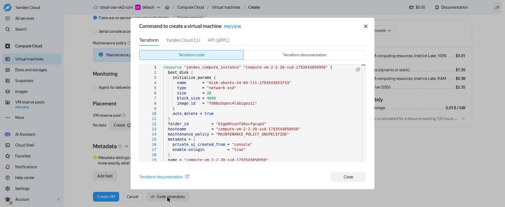
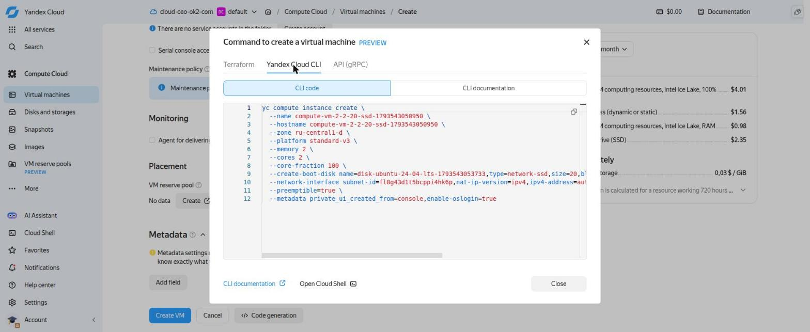
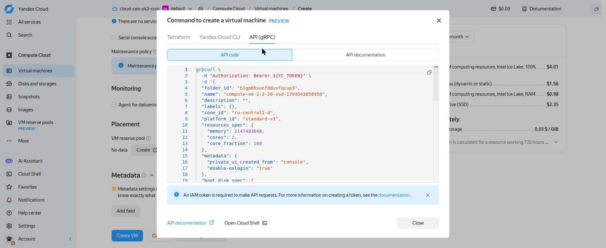

**چه نیازی را حل می‌کند:** کاربر حرفه‌ای همان چیزی را که در UI ساخته، در زیرساخت‌به‌عنوان‌کد (IaC) تکرار می‌کند. **برای ایران سرور:** اگر API عمومی سرور ابری داریم، «تولید کد curl از روی فرم» برای نمایندگان API بسیار کاربردی است.

---

## ۱۲. جعبه‌ی قیمت (سمت راست فرم)

- قیمت کل با سوئیچ **per month** یا **per hour**، به‌علاوه‌ی ریز اقلام: CPU (با ذکر پلتفرم و درصد)، RAM، IP عمومی، دیسک و بکاپ
- بخش جدای «**Paid separately**» برای هزینه‌های مصرفی مثل حجم بکاپ و اسنپ‌شات
- توضیح: قیمت ماهانه بر پایه‌ی **۷۲۰ ساعت** است و **ترافیک خروجی** در آن حساب نشده است.
- وسط محاسبه‌ی دوباره، جعبه کم‌رنگ می‌شود و لودینگ نشان می‌دهد.

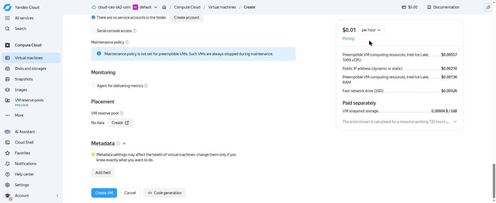

---

## ماشینی که ساخته شد

با تأیید شما یک ماشین تست با ارزان‌ترین کانفیگ معقول ساخته شد:

| مشخصه | مقدار |
|---|---|
| نام | `iranserver-test-vm` |
| ID | `fv4a8vig69ipkct7jbn3` |
| سیستم‌عامل | Ubuntu 24.04 LTS (Marketplace، Free) |
| زون | ru-central1-d |
| منابع | Intel Ice Lake، ۲ vCPU با ۲۰٪ تضمینی، ۲ گیگ RAM |
| دیسک | HDD ده‌گیگی (۳۰۰ IOPS) |
| Preemptible | بله |
| شبکه | IP داخلی 10.130.0.20 · IP عمومی پویا 84.201.170.123 |
| دسترسی | OS Login |
| بکاپ | خاموش |
| قیمت | **۴٫۷۸ دلار در ماه** (حدود ۰٫۰۰۶۶ دلار در ساعت): CPU ۱٫۹۶، IP ۱٫۵۶، RAM ۰٫۹۸ و HDD ۰٫۲۸ |

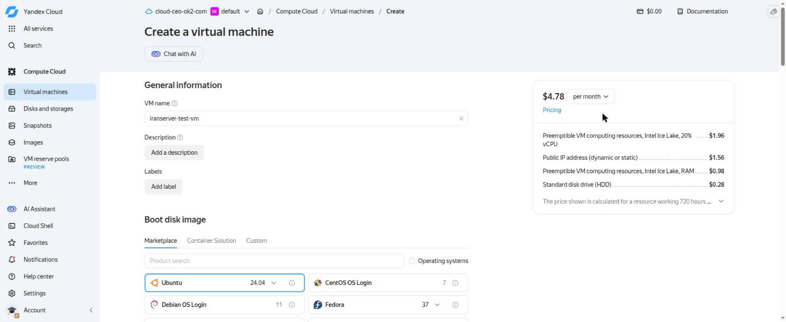

**زمان‌بندی:** ساعت ۱۸:۰۴ ثبت شد و حدود ۳۰ ثانیه بعد وضعیت به ترتیب Provisioning، سپس Starting و بعد Running شد. Operation ساخت ساعت ۱۸:۰۵ Completed شد. IP عمومی در همان مرحله‌ی Provisioning تخصیص داده شد.

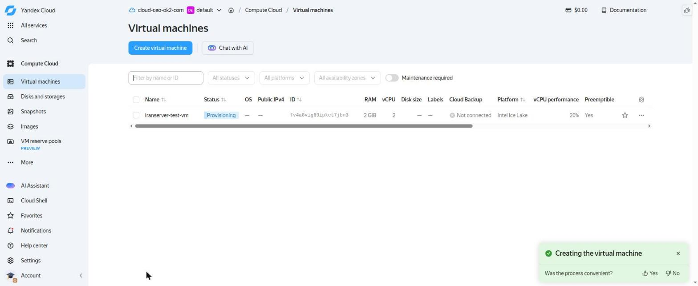

---

## صفحه‌ی جزئیات سرویس

### هدر صفحه

نام، وضعیت (Running)، ID قابل کپی و این دکمه‌ها:
- **Connect in Cloud Shell:** ترمینال داخل مرورگر که مستقیم به VM وصل می‌شود
- **Edit:** ویرایش کانفیگ
- **منوی ⋯:** Stop، Restart، View on map (نقشه‌ی زیرساخت) و Delete
- **Chat with AI**
- جعبه‌ی قیمت همیشه بالای صفحه است.

در لیست ماشین‌ها هم هر ردیف منوی ⋯ دارد. در حالت Starting فقط View on map و Delete در آن فعال است.

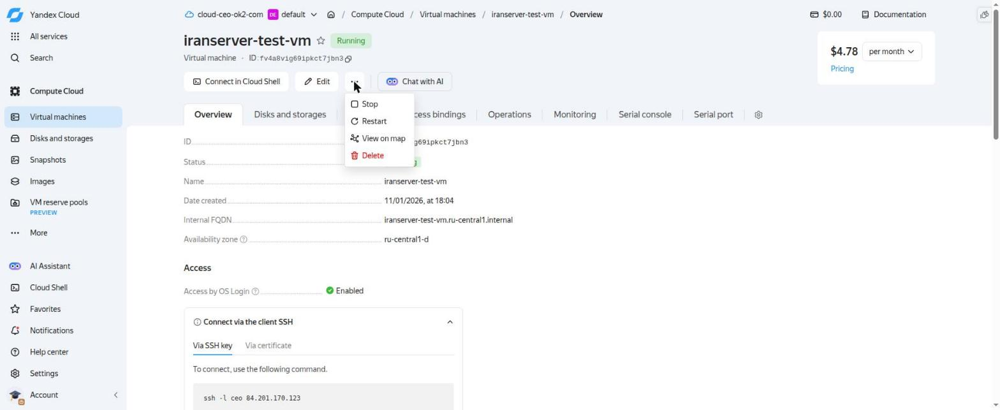
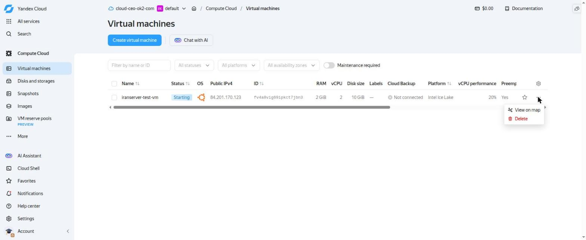

### تب‌ها

| تب | محتوا | چه نیازی را حل می‌کند |
|---|---|---|
| **Overview** | ID، وضعیت، تاریخ ساخت، **FQDN داخلی** (`iranserver-test-vm.ru-central1.internal`)، زون؛ بخش Access با **دستور آماده‌ی اتصال** (`ssh -l ceo 84.201.170.123`)، تب‌های «Via SSH key» و «Via certificate»، دکمه‌ی «Add new SSH key» و راهنمای اتصال با CLI؛ منابع؛ نام اپلیکیشن Marketplace و نوع قیمت آن؛ شبکه؛ بکاپ؛ مانیتورینگ؛ تنظیمات پیشرفته؛ متادیتا | همه‌چیز در یک صفحه، با راهنمای اتصال برای کاربر تازه‌کار |
| **Disks and storages** | لیست دیسک‌ها (نوع، حجم، وضعیت، رمزنگاری، زون، Placement group) و زیرتب File storages؛ دکمه‌ی Attach disk. منوی هر دیسک: Edit، **Create snapshot**، **Create image**، **Increase disk size**، **Edit snapshot schedules** | مدیریت کامل دیسک بدون رفتن به بخش جدا |
| **Backups** | لیست بکاپ‌های Cloud Backup و دکمه‌ی Create backup | بازیابی سریع |
| **Access bindings** | نقش‌های IAM روی همین VM، Assign roles و نمایش نقش‌های ارثی (organization owner، clouds owner) | دادن دسترسی یک سرور به یک نفر بدون دسترسی به کل حساب |
| **Operations** | تاریخچه‌ی عملیات: ID، وضعیت، کاربر، نوع عملیات، زمان شروع و پایان، پیام خطا | ممیزی (audit) و پیگیری خطا |
| **Monitoring** | نمودارهای CPU Utilization، Disk bytes، Disk operations، Network bytes، Network packets و Connections quota utilization؛ بازه‌های ۱ ساعت، ۳ ساعت، ۱ روز، ۱ هفته و ۱ ماه؛ رفرش خودکار؛ لینک «Open in Monium» | دیدن مصرف منابع بدون ابزار جانبی |
| **Serial console** | کنسول تعاملی؛ اگر هنگام ساخت فعال نشده باشد دکمه‌ی **Allow** دارد | نجات سرور وقتی SSH قطع است |
| **Serial port** | خروجی پورت سریال (COM1) با حالت Raw | دیدن لاگ بوت و خطای kernel |
| **⚙ (چرخ‌دنده)** | شخصی‌سازی ترتیب و نمایش تب‌ها | پنل قابل تنظیم برای کاربر |

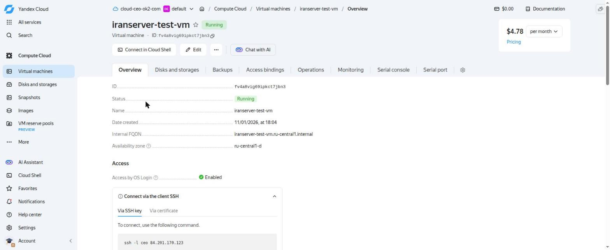
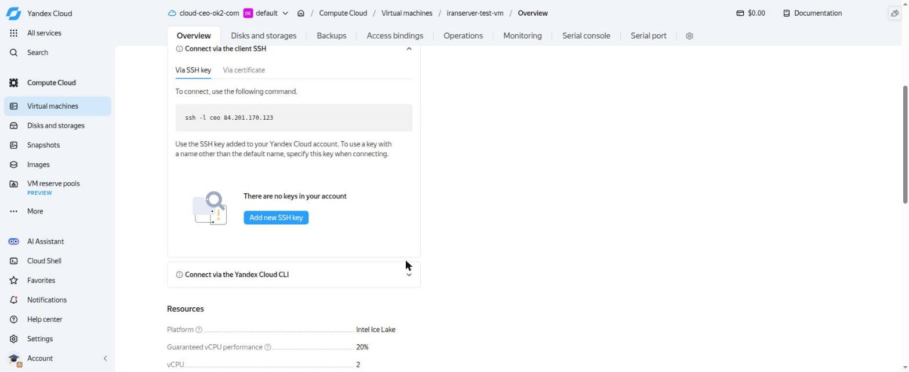
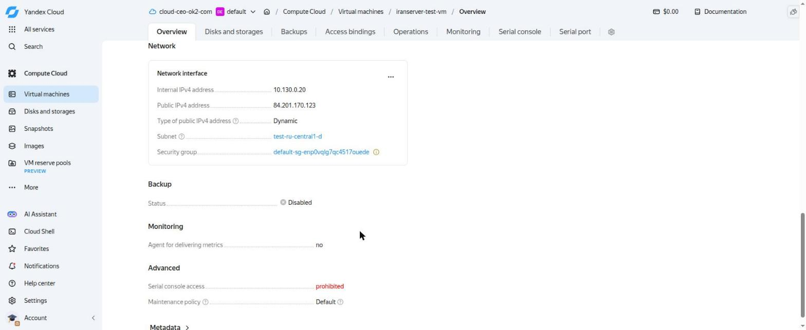
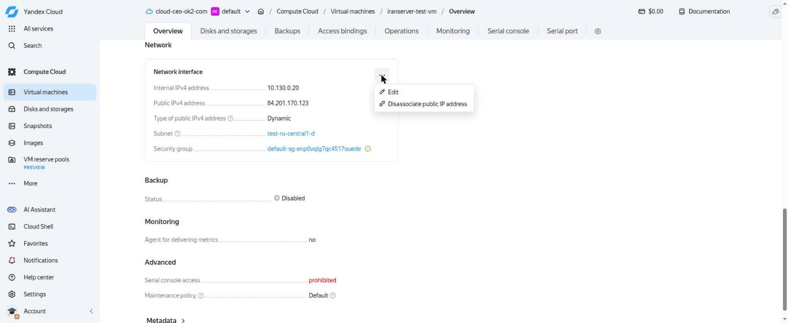
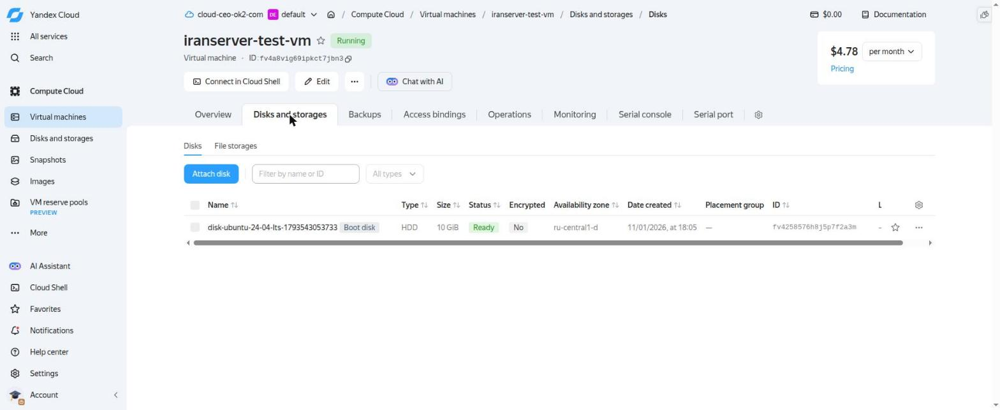

**منوی کارت شبکه** در Overview دو گزینه دارد: Edit و **Disassociate public IP address** (جدا کردن IP عمومی بدون حذف سرور).

### ویرایش ماشین روشن (Edit)

- در حالت روشن فقط نام، توضیح، برچسب، دسترسی و متادیتا قابل تغییر است.
- برای **تغییر منابع** (پلتفرم، vCPU، RAM، درصد CPU، Preemptible) پیام «To change available resources, stop the VM» نمایش داده می‌شود. **ارتقا یا کاهش منابع بدون خاموشی ممکن نیست.**
- **فعال کردن Cloud Backup** هم خاموش بودن VM را لازم دارد.
- زمان‌بندی اسنپ‌شات از صفحه‌ی دیسک تنظیم می‌شود.

---

## مشاهدات و محدودیت‌ها

1. **فرم یک‌صفحه‌ای با پیش‌فرض‌های کامل:** کاربر می‌تواند فقط Access را پر کند و Create بزند؛ همه‌ی بخش‌های دیگر پیش‌فرض معقول دارند.
2. **قیمت زنده و شفاف:** هر تغییر فوراً روی قیمت و ریز اقلام اثر می‌گذارد. قیمت ساعتی و ماهانه هر دو در دسترس است.
3. **بکاپ پیش‌فرض روشن است** و ۲٫۳۰ دلار در ماه اضافه می‌کند. این الگوی upsell است، ولی مشتری ناآگاه را غافلگیر می‌کند.
4. **IP عمومی پیش‌فرض پویا است**؛ برای IP ثابت باید از قبل در بخش VPC آدرس رزرو شود.
5. **زون ru-central1-b بسته است** و پلتفرم‌های قدیمی Broadwell و V100 هم غیرفعال‌اند.
6. **کوتای GPU** به‌طور پیش‌فرض صفر است (علامت زرد کنار پلتفرم‌های GPU).
7. **تغییر منابع فقط با خاموش کردن VM** ممکن است (بدون hot-resize).
8. **Preemptible سیاست نگهداری ندارد** و هنگام نگهداری همیشه متوقف می‌شود.
9. حساب فعلی **سرویس اکانت ندارد**، پس ایجنت مانیتورینگ و Cloud Backup بدون ساخت آن کار نمی‌کنند.

---

## پیشنهادها برای پنل سرور ابری ایران سرور (OpenStack و Ceph)

| الگوی یاندکس | پیاده‌سازی پیشنهادی در ایران سرور | اولویت |
|---|---|---|
| جعبه‌ی قیمت زنده با ریز اقلام و سوئیچ ساعتی/ماهانه | محاسبه‌ی سمت فرانت از جدول قیمت WHMCS یا سرویس قیمت؛ پایه‌ی محصول «پرداخت ساعتی» | بالا |
| تب‌های پریست (Standard، High memory، Shared-core) به‌علاوه‌ی Custom | گروه‌بندی flavorهای Nova؛ Shared-core با CPU overcommit و `quota:cpu_shares` | بالا |
| درصد کارایی تضمینی vCPU (۲۰/۵۰/۱۰۰) | flavor extra_spec `quota:cpu_quota` و `cpu_period` | متوسط |
| Preemptible | flavor با `preemptible=true` و reaper، طبق طرح قبلی (shelve_offload) | متوسط |
| نوع دیسک با نمایش IOPS متناسب با حجم | volume type در Cinder با QoS روی Ceph | بالا |
| Generate key داخل فرم | تولید keypair در Nova و دانلود کلید خصوصی یک‌باره | بالا |
| IP عمومی Auto / List / No address و جدا کردن IP | Floating IP در Neutron: تخصیص خودکار، انتخاب از رزروشده‌ها یا بدون IP | بالا |
| Security group پیش‌فرض و ساخت گروه از داخل فرم | Neutron security groups | بالا |
| Disk snapshot با زمان‌بندی | Cinder snapshot به‌علاوه‌ی زمان‌بند (cron یا Mistral) | متوسط |
| Container Solution (کانتینر روی VM) | ایمیج آماده‌ی Docker و cloud-init که compose را اجرا کند | پایین |
| Code generation | نمایش درخواست API یا curl معادل فرم برای نمایندگان | متوسط |
| تب Operations (تاریخچه‌ی عملیات) | لاگ عملیات پنل به‌علاوه‌ی Nova instance actions | بالا |
| تب Monitoring | Ceilometer/Gnocchi یا Prometheus با نمودار در پنل | متوسط |
| Serial console و Serial port | noVNC و `nova console-log` | بالا (احتمالاً موجود) |
| دستور آماده‌ی اتصال SSH در Overview | نمایش `ssh user@ip` با نام کاربر پیش‌فرض ایمیج | بالا، کم‌هزینه |

---

## وضعیت ماشین تست

ماشین `iranserver-test-vm` در زمان نوشتن این سند **روشن است** و تا حذف یا خاموش شدن حدود ۰٫۰۰۶۶ دلار در ساعت هزینه دارد. چون Preemptible است، یاندکس حداکثر بعد از ۲۴ ساعت آن را خودکار متوقف می‌کند، ولی هزینه‌ی دیسک تا حذف ماشین ادامه دارد.
